# Figures

All figures of the analysis in one place, grouped by part. They are **copies** of the figures in `reports/<part>/` (the notebooks read them from there); refresh the copies with `python scripts/collect_figures.py .` after re-running an analysis.

| part | folder | figures |
|---|---|---|
| 1. PCA embeddings of the NTC cells | [`01_pca_embeddings/`](#1-pca-embeddings-of-the-ntc-cells) | 4 |
| 2a. Cell cycle phase score from markers + DNA content (circular, main score) | [`02_score_markers_dna/`](#2a-cell-cycle-phase-score-from-markers--dna-content-circular-main-score) | 5 |
| 2b. Open-ended score from markers only (no DNA) | [`02_score_markers_only/`](#2b-open-ended-score-from-markers-only-no-dna) | 4 |
| 3. Predicting the phase from phase contrast (NTC cells) | [`03_phase_contrast_prediction/`](#3-predicting-the-phase-from-phase-contrast-ntc-cells) | 6 |
| 4a. Knockout cells (CCNB1, MCM3, CENPC) against NTC | [`04_knockout_evaluation/`](#4a-knockout-cells-ccnb1-mcm3-cenpc-against-ntc) | 9 |
| 4b. Guide-level analysis | [`04_knockout_guide_analysis/`](#4b-guide-level-analysis) | 6 |
| 4c. Cell density and marker profiles across the cell cycle, per gene | [`04_knockout_density_profiles/`](#4c-cell-density-and-marker-profiles-across-the-cell-cycle-per-gene) | 2 |

## 1. PCA embeddings of the NTC cells

Made by `notebooks/13_ops0077_marker_pca_cell_cycle_clock.ipynb`. Data: `reports/ops0077_cell_cycle_clock/`. These embeddings describe how the p21, Rb and pRb features organise the NTC cells; they are not cell cycle scores.

**`embedding_by_marker.png`**  
2-D marker embedding (PC1 vs PC2 of the three log-transformed mean intensities), one panel per marker coloured by that marker's intensity. The gradients show what the axes encode (mostly overall staining intensity).

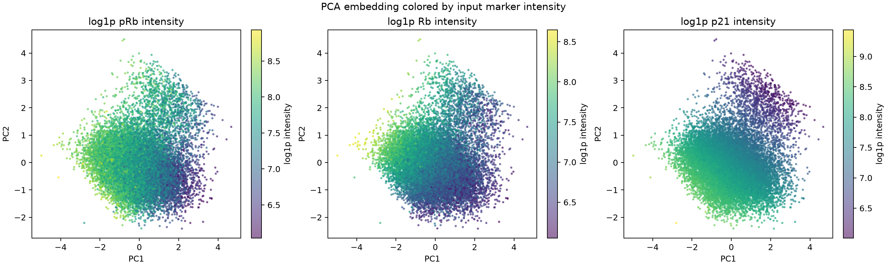

**`embedding_by_well.png`**  
The same embedding coloured by well, a check for technical structure.

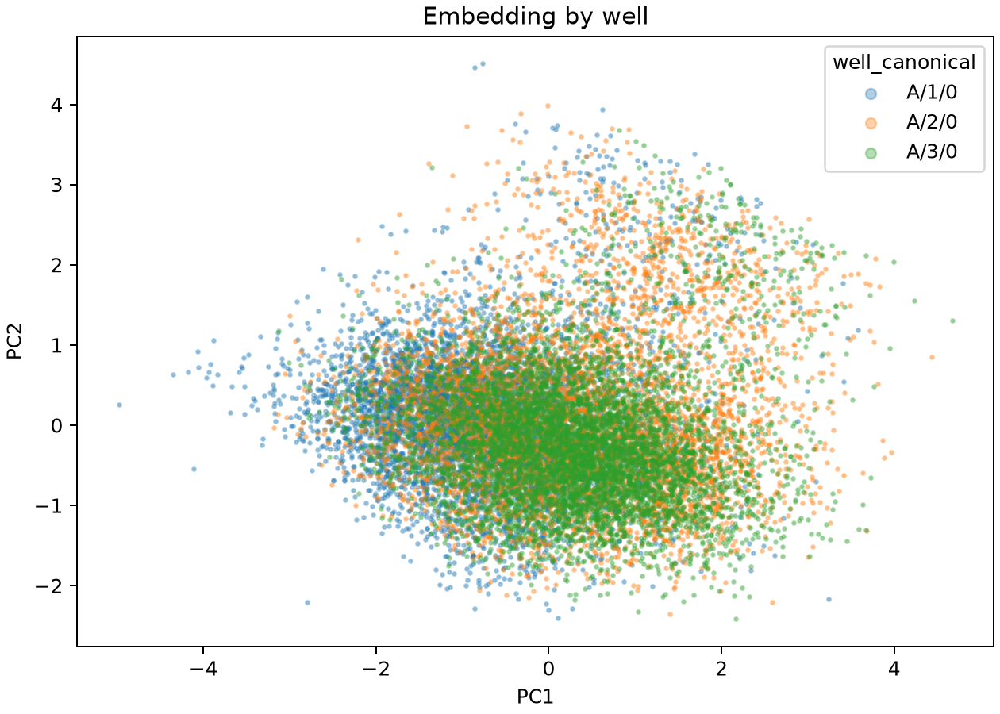

**`per_cell_pca_comparison.png`**  
PC1 vs PC2 of per-cell feature blocks: pRb, Rb and p21 features separately, the three channels combined, the cross-channel colocalisation features, and both together.

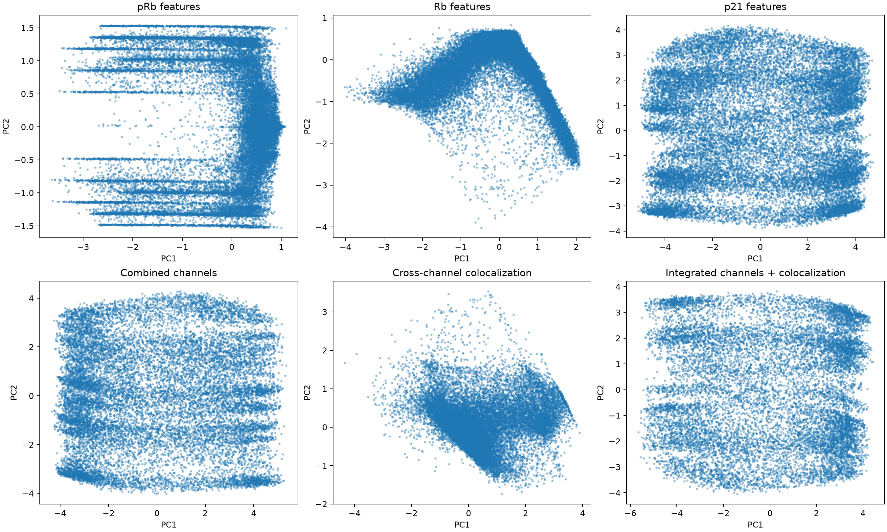

**`per_cell_pca_pairwise_comparison.png`**  
For each channel pair (pRb-Rb, pRb-p21, Rb-p21, rows): PCA of the two channels' features, of the pair's colocalisation features only, and of both together (columns). The PCs of these blocks are the optional extra layer of the scores.

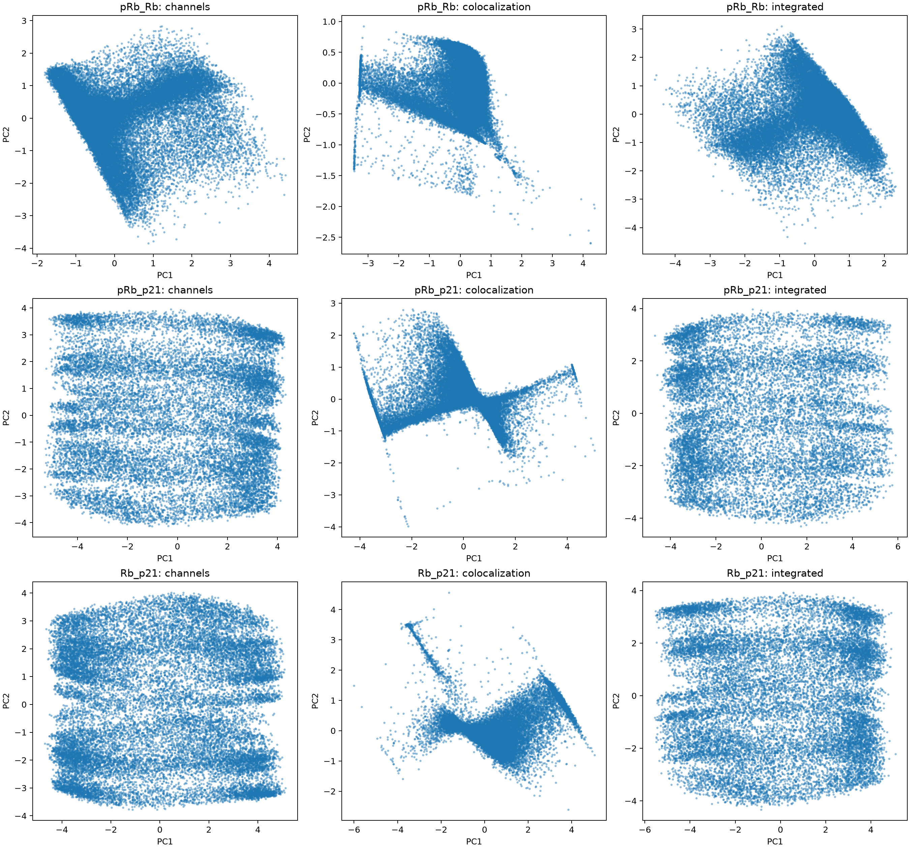

## 2a. Cell cycle phase score from markers + DNA content (circular, main score)

Made by `scripts/ops0077_cell_cycle_score.py`. Data: `reports/ops0077_cell_cycle_score/`. Explained in [docs/SCORE_CALCULATION.md](../docs/SCORE_CALCULATION.md). Phase 0 is the start of G1 and 0 and 1 are the same point; the colour map for phase is cyclic.

**`marker_profiles.png`**  
Left: median and interquartile range of the phosphorylated Rb fraction, p21, pRb and DNA content along the phase (dashed: log nuclear area). Right: density of cells along the cycle. Check: DNA peaks around phase 0.55 to 0.6, p21 is lowest around S.

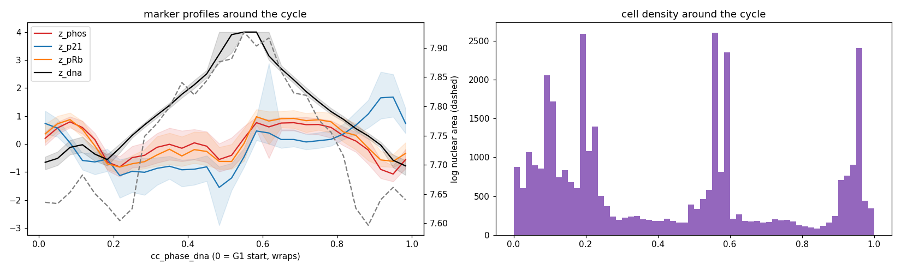

**`phase_planes.png`**  
Cells in pairs of the fitted axes (DNA vs phosphorylated Rb, DNA vs p21, pRb vs p21) coloured by phase: the cycle appears as an ordered loop.

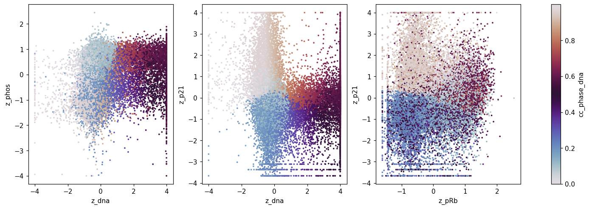

**`umap_overview.png`**  
UMAP of the four axes coloured by the phase (markers + DNA), each axis, nuclear area, the markers-only phase and the final phase.

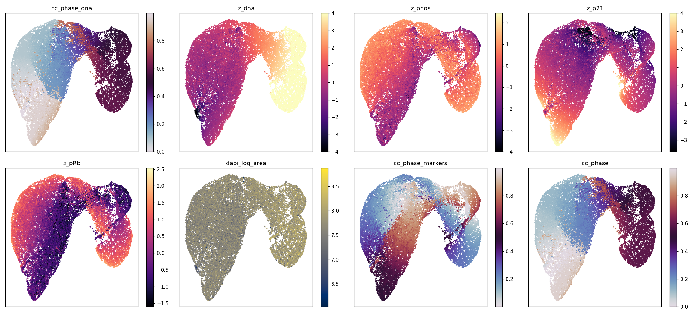

**`score_distributions.png`**  
Phase by well; markers-only phase against the DNA-anchored phase (poor agreement: DNA content is essential); effect of the PC layer (small).

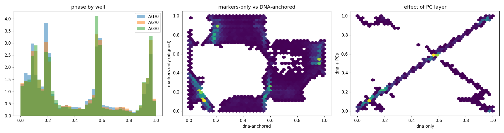

**`marker_score_pca_visualization.png`**  
From the earlier heuristic marker score (`scripts/score_ops0077_cell_cycle_markers.py`): PCA of the three markers coloured by its within-well G1-to-S progression proxy. For visualisation only; the PCA does not enter that score.

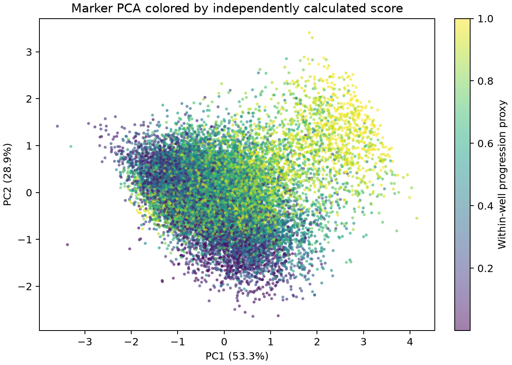

## 2b. Open-ended score from markers only (no DNA)

Made by `scripts/ops0077_cell_cycle_score_only_markers.py`; file names carry the suffix `_only_markers`. Data: `reports/ops0077_cell_cycle_score_only_markers/`. Written to show later what DNA content adds. The score runs from 0 to 1 and its ends do not join.

**`marker_profiles_only_markers.png`**  
Marker profiles along the intensity-only score and the PC-combined score, and the probability of each biological state (G0/early G1, late G1, S, G2/M; mixture model) along the score.

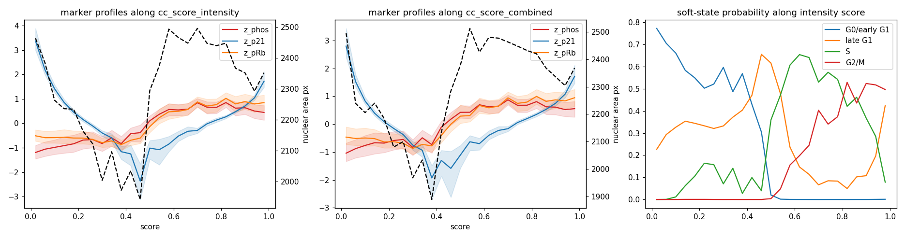

**`phase_planes_only_markers.png`**  
log Rb vs log pRb, phosphorylated Rb fraction vs p21, and pRb vs p21, coloured by the score.

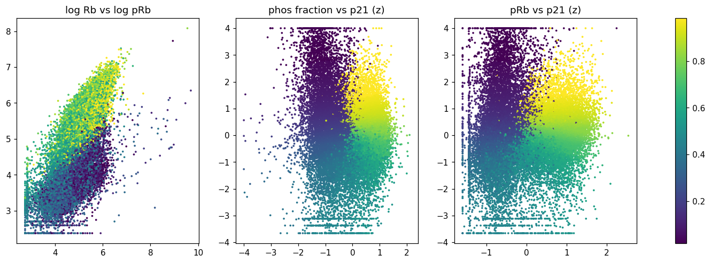

**`umap_overview_only_markers.png`**  
UMAP of the three axes coloured by the score, each axis, nuclear area, well, the expected stage of the mixture model, and the PC-combined score.

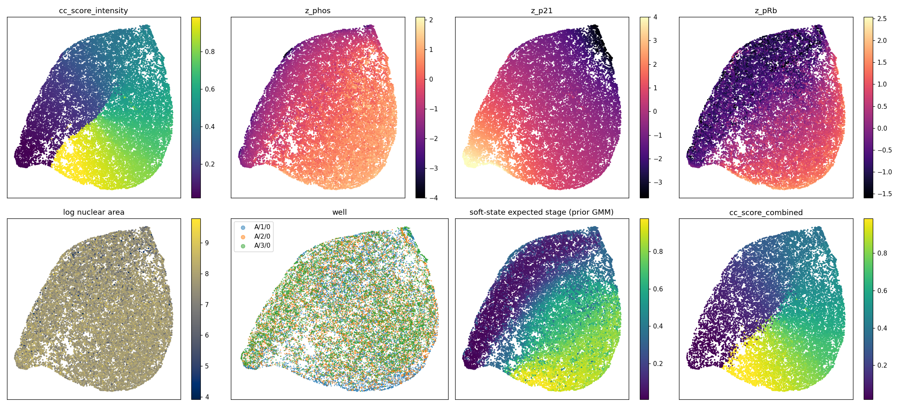

**`score_distributions_only_markers.png`**  
Score by well, and intensity-only against PC-combined score.

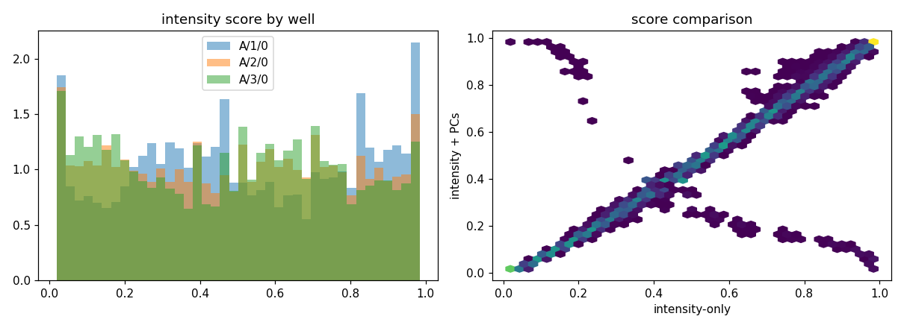

## 3. Predicting the phase from phase contrast (NTC cells)

Made by `scripts/ops0077_phase_predict_cc_phase.py`. Data: `reports/ops0077_phase_predicts_cc_phase/`. All predictions shown are out-of-fold. Explained in [docs/PREDICTION.md](../docs/PREDICTION.md) and [docs/EVALUATION.md](../docs/EVALUATION.md). A random guess has a mean circular error of 0.25 turns.

**`qc_pred_vs_true.png`**  
Predicted against true phase (the dashed diagonals wrap around the circle), histogram of the circular error, and its polar view.

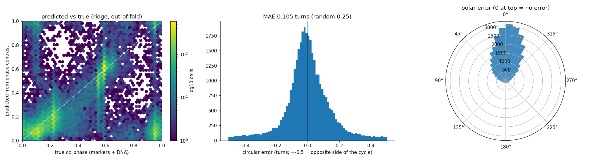

**`qc_error_by_phase.png`**  
Absolute error by true phase bin, and the confusion between 8 phase bins.

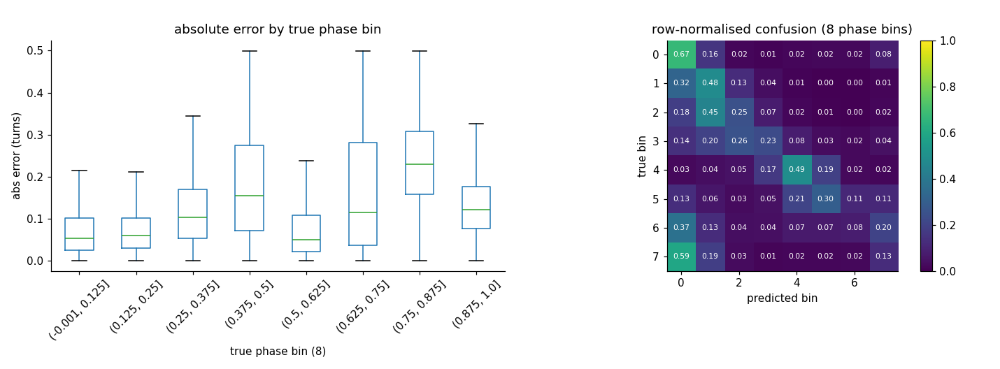

**`qc_error_drivers.png`**  
What drives the error: prediction confidence, coverage, registration distance between live and fixed imaging, well, quality of the label, number of cells in the tile.

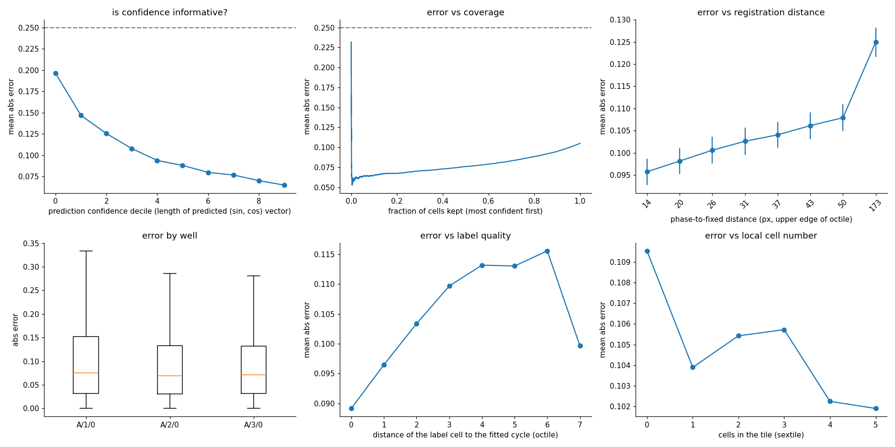

**`qc_model_comparison.png`**  
Models against baselines (cell size only; registration distance and cell number only), tile-grouped and leave-one-well-out validation, and the CellProfiler-texture comparison.

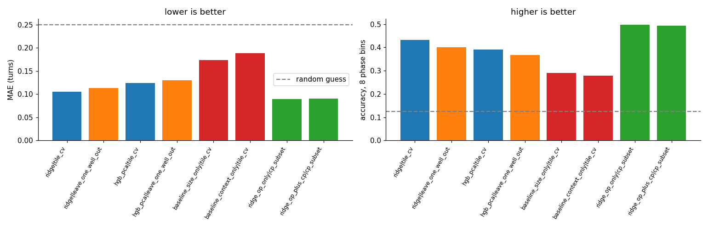

**`qc_profiles_true_vs_predicted.png`**  
DNA and marker profiles along the true phase and along the predicted phase: the predicted phase preserves the biology.

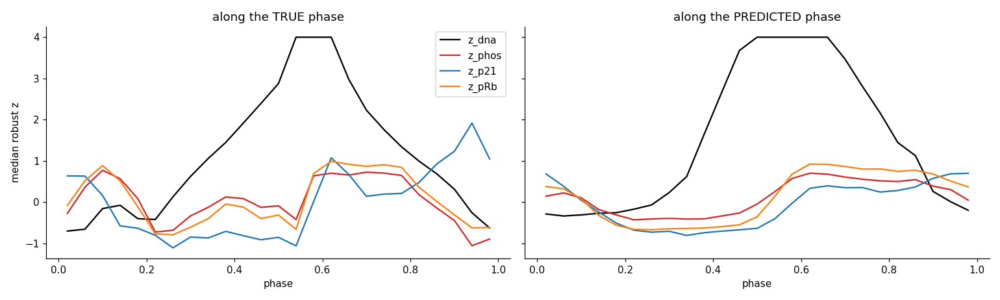

**`qc_feature_groups_and_top_features.png`**  
Performance with each feature group alone or left out, and the strongest single features.

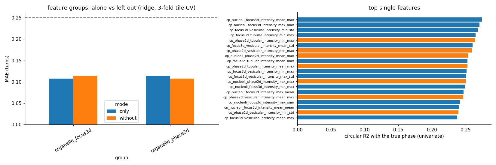

## 4a. Knockout cells (CCNB1, MCM3, CENPC) against NTC

Made by `scripts/ops0077_cc_transfer/evaluate_cc_transfer.py`. Data: `reports/ops0077_cc_transfer/ko3_evaluation/`. Sectors (G1, S, G2/M, M-to-G1 exit) are defined from the NTC curve only; shading in the figures marks them.

**`fig1_phase_distributions_vs_ntc.png`**  
Distribution of the phase around the cycle for each gene against NTC: polar view of the stain score, polar view of the phase-contrast score, and a linear view.

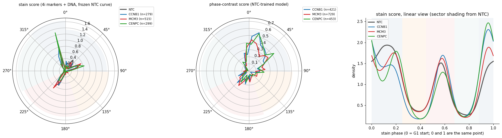

**`fig2_sector_fractions.png`**  
Fraction of cells per sector, NTC and each gene, for the stain score and the phase-contrast score, with 95% bootstrap intervals.

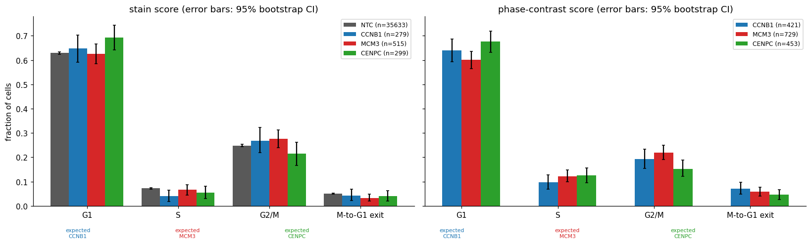

**`fig3_sector_shift_heatmap.png`**  
Change in the fraction of cells per sector against NTC, with intervals; the permutation p-value of a shift of the mean phase is next to each gene.

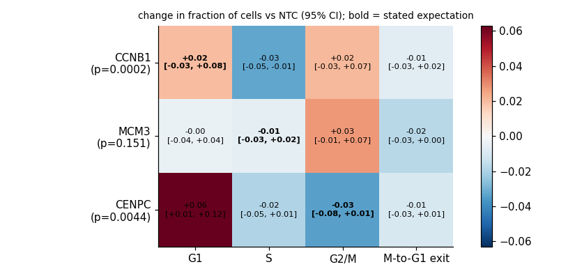

**`fig4_replicates_guide_and_well.png`**  
Sector composition per guide and per well (guides are the 20-nt protospacers).

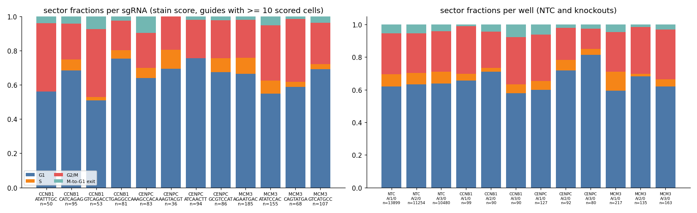

**`fig5_profiles_knockout_vs_ntc.png`**  
DNA and marker profiles along the phase for each gene on top of the NTC band: the knockout cells follow the NTC cycle.

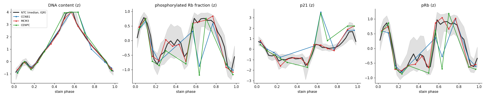

**`fig6_support_and_distance_to_ntc_curve.png`**  
Distance of the cells to the NTC cycle curve, fraction of cells off the NTC cycle per gene, and the cells in DNA vs p21 space.

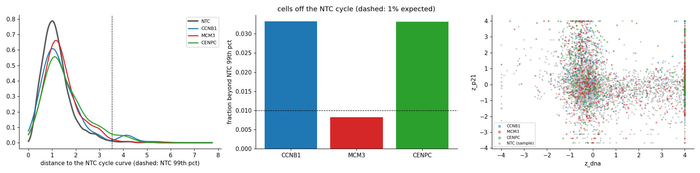

**`fig7_stain_vs_phase_contrast_scores.png`**  
The two independent scores compared cell by cell for each gene, and the circular error.

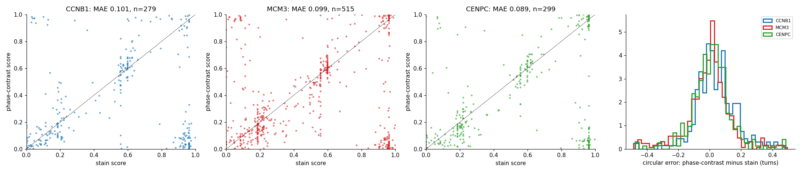

**`fig8_comparison_with_file_reference_columns.png`**  
Our stain sectors against the gating columns that came with the input file (not used as inputs), and against the file's own phase-contrast predictor.

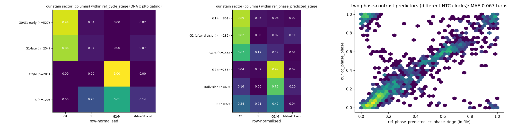

**`fig9_dna_reference_check.png`**  
DNA content densities per well, NTC against knockouts: the lowest-DNA (2N) peak should sit at the same place if the DNA content is on the same reference.

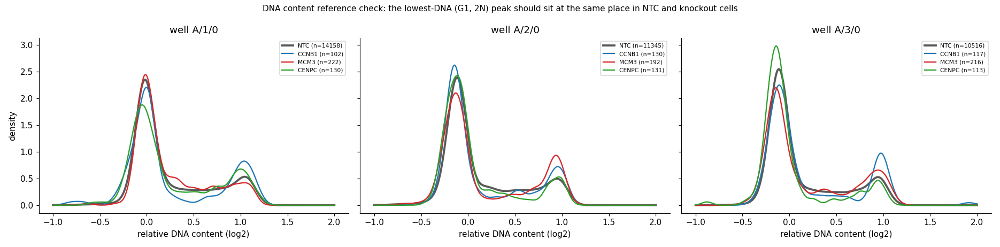

## 4b. Guide-level analysis

Made by `scripts/ops0077_cc_transfer/guide_level_analysis.py`. Data: `reports/ops0077_cc_transfer/ko3_guide_analysis/`. Four guides per gene, compared against NTC re-weighted to each guide's own well mix.

**`g1_guide_shift_forest.png`**  
Change in the fraction of cells in G1, S and G2/M for each guide against NTC (well-matched), with 95% bootstrap intervals. Filled: stain-scored cells; open: all cells.

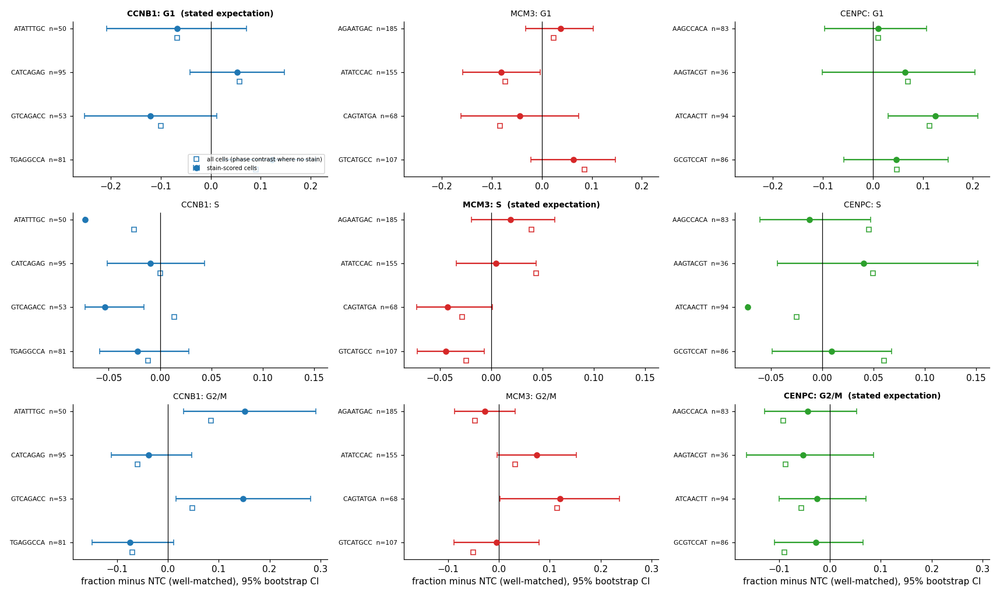

**`g2_guide_density_along_cycle.png`**  
Density of cells along the cycle for each guide, against NTC (top, stain score; bottom, phase-contrast score for all cells).

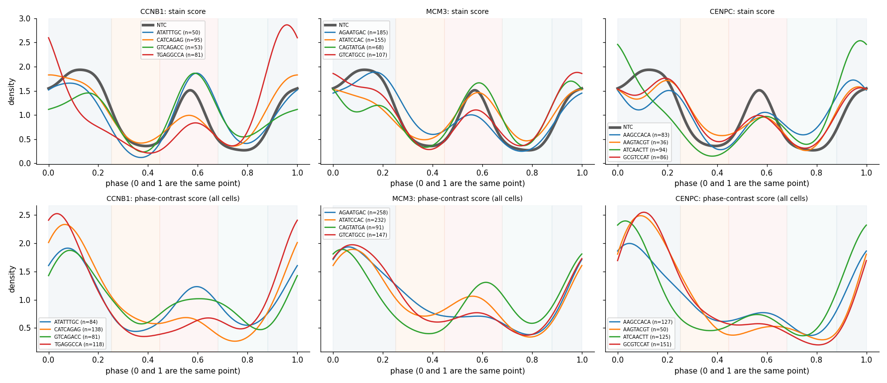

**`g3_guide_effect_concordance_disjoint_cells.png`**  
Is a guide effect real? The same guide's sector fraction in two disjoint sets of cells, measured by different instruments (stain vs phase contrast), one point per guide.

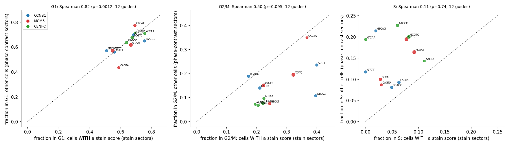

**`g4_guide_phenotypes_ranked_by_g2m_shift.png`**  
Guides ranked by their G2/M shift, with other phenotypes (nuclear size, p21, DNA beyond 4N, cells off the NTC cycle) against NTC.

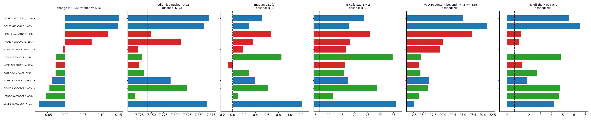

**`g5_heterogeneity_tests.png`**  
Do the guides of one gene differ more than chance? Permutation p-values (guide labels shuffled within wells).

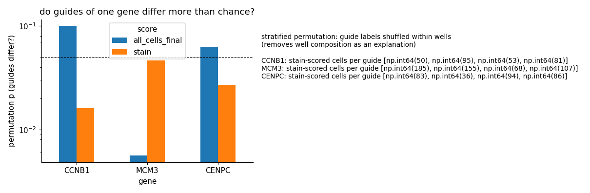

**`g6_guide_well_composition.png`**  
Well composition of each guide's cells (the NTC fractions are re-weighted to this mix).

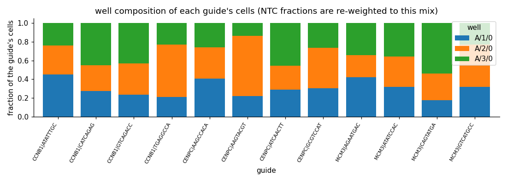

## 4c. Cell density and marker profiles across the cell cycle, per gene

Made by `scripts/ops0077_cc_transfer/plot_density_profiles_by_gene.py`, in the style of the NTC `marker_profiles.png`. Data: `reports/ops0077_cc_transfer/ko3_density_profiles/`.

**`density_profiles_by_gene_stain_score.png`**  
Top: median and interquartile range of the markers and DNA content along the stain phase (dashed: log nuclear area). Bottom: density of cells along the cycle, with the NTC density as a grey step.

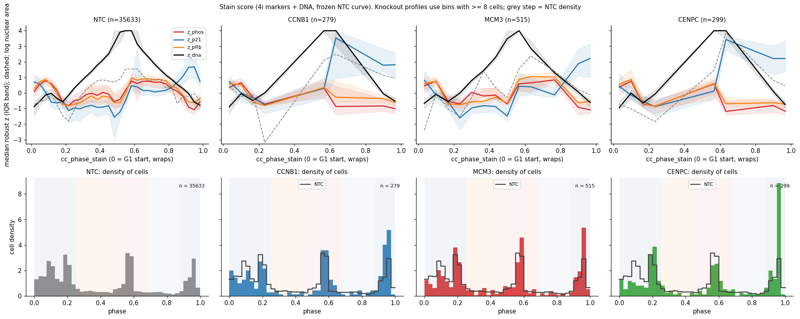

**`density_profiles_by_gene_phase_contrast_score.png`**  
The same for the phase-contrast score, which covers every cell.

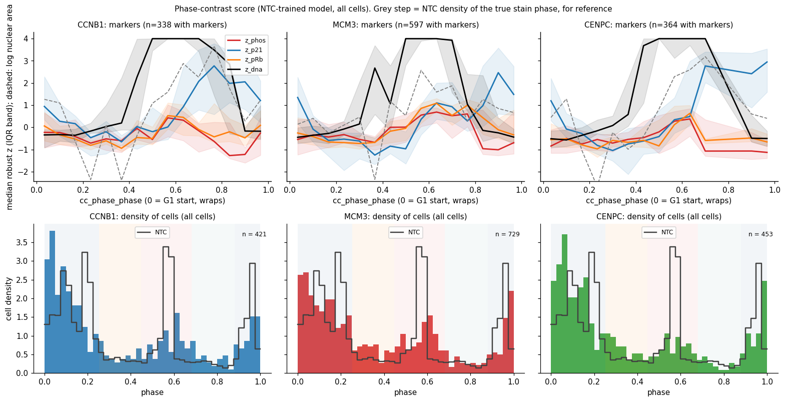
